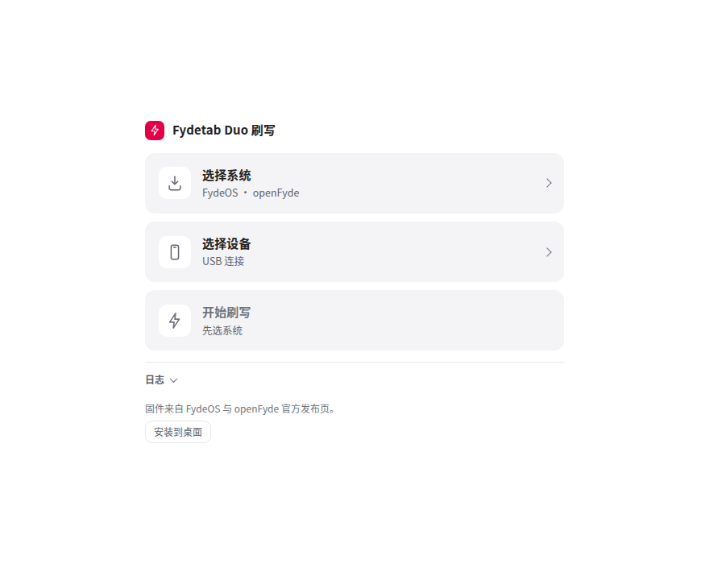
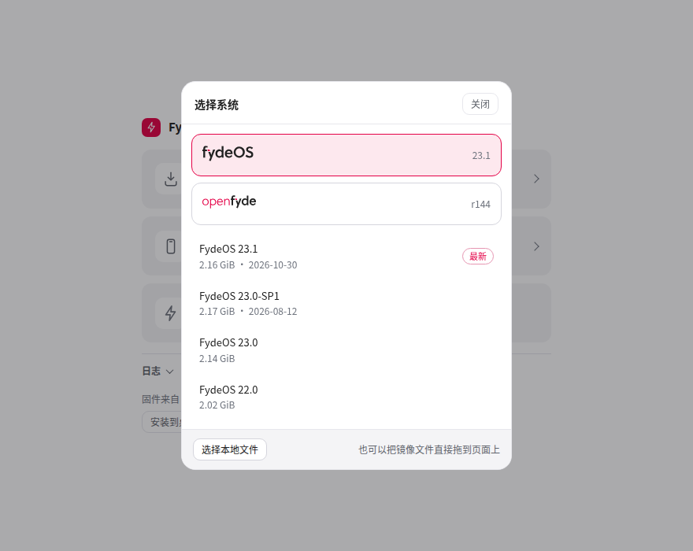
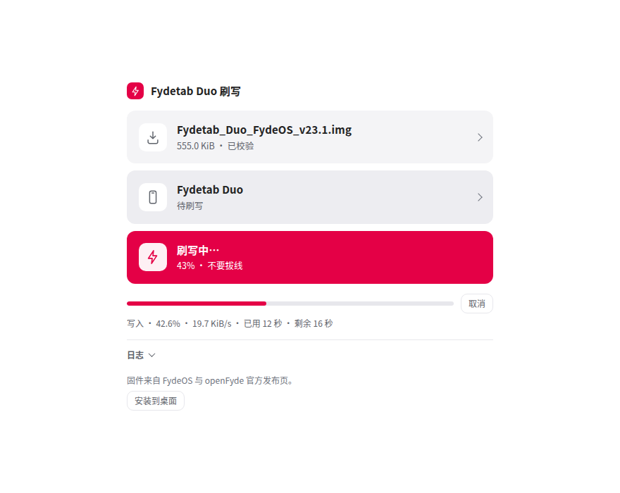
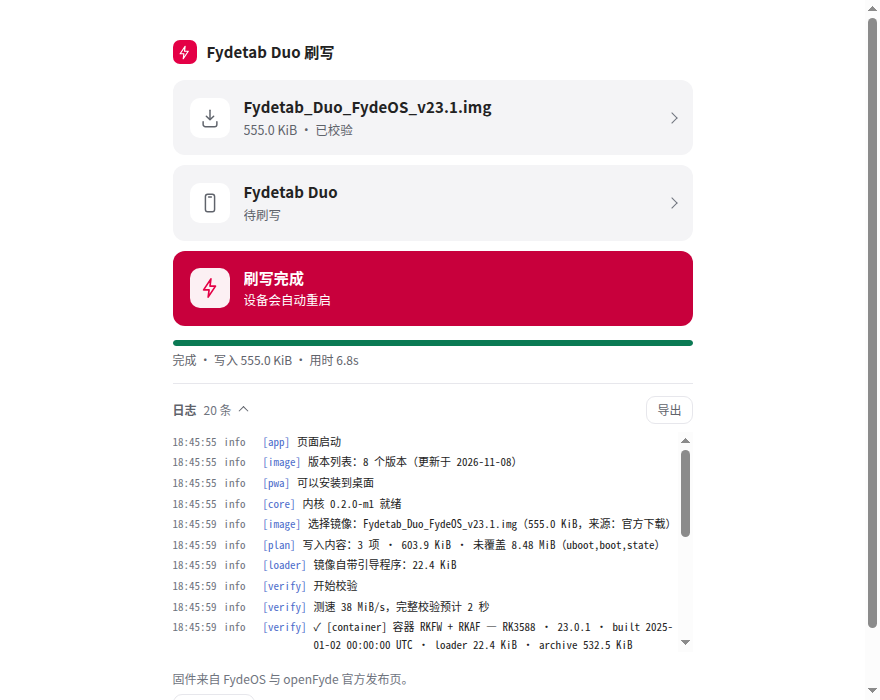
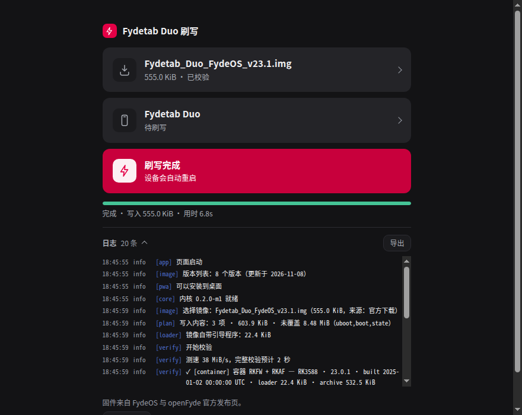
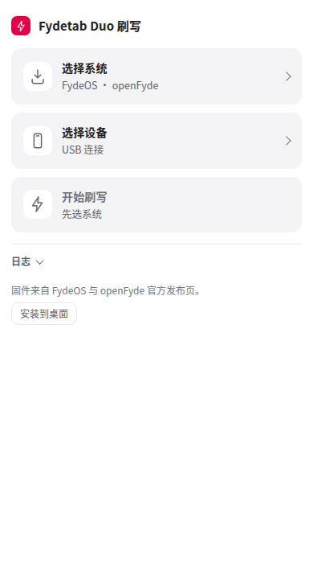

# fydetab-flash-web

**English** · [简体中文](README.zh-CN.md)

A browser-based ROM flasher built specifically for the **Fydetab Duo (RK3588)**. It runs on any machine with
Chrome / Chromium — macOS, Linux, Windows, ARM boxes — so the vendor's `upgrade_tool`, which only ships for
x86 Linux and Windows, is no longer in the way.

No backend, no upload, nothing to install: the rockusb protocol and the write state machine are Go compiled to
WebAssembly, USB goes through WebUSB, and images never leave your machine.

## Screenshots

<table width="100%">
  <tr>
    <td width="33%" align="center"> Idle — pick a system, pick a device, flash</td>
    <td width="33%" align="center"> Download an image: brand first, then release</td>
    <td width="33%" align="center"> Writing — the third tile turns brand red</td>
  </tr>
  <tr>
    <td width="33%" align="center"> Done — the device reboots by itself</td>
    <td width="33%" align="center"> Dark theme follows the system</td>
    <td width="33%" align="center"> 390px — one column, no overflow</td>
  </tr>
</table>

## Flash a device

1. **Enter flash mode.** Power the tablet off, connect USB, hold **Vol+**, tap **Power**, then release Power
   and Vol+. In MASKROM the page sends Download Boot by itself — click no read button before that.
2. **Download an image (optional).** Click the first tile, choose FydeOS or openFyde and a release. The
   browser starts its own download; the page keeps no progress and never asks you to come back. Skip this
   tile entirely if you already have the file.
3. **Choose a local image.** Click the second tile (or drop a file on the page) and pick the `.img` / official
   `.zip`. This step is independent of the first one.
4. **Connect the device.** Click the third tile and select the `0x2207` device in the browser prompt.
5. **Verify.** Parsing, PARM CRC, RKAF CRC and whole-image MD5 run by themselves; one line shows the verdict.
6. **Flash.** If the image leaves storage uncovered, say what to do with the tail, then click *Start flash*.
   Progress, speed and ETA sit under the last tile; you can cancel at any point.
7. **Watch the log.** Collapsed by default, opens on errors, exports NDJSON. Keep it when something fails.

Needs Chrome / Edge / Chromium ≥ 89 and a USB-C cable that actually carries data. Linux wants a
[udev rule](docs/99-rockchip-webusb.rules), Windows wants WinUSB, macOS wants nothing.

## Docs

Detailed docs are currently in Chinese: **[docs/README.md](docs/README.md)**.

- First flash, step by step: [docs/quickstart.md](docs/quickstart.md)
- Page walkthrough — the long version of the six steps above: [docs/usage-web.md](docs/usage-web.md)
- Drivers, permissions, offline PWA: [docs/webusb-drivers.md](docs/webusb-drivers.md), [docs/pwa-offline.md](docs/pwa-offline.md)
- Build it yourself: [docs/development.md](docs/development.md)

## License

GPL-2.0, see [LICENSE](LICENSE). No `upgrade_tool` binary and no Rockchip loader blob is distributed here; the
loader is sliced out of the image you provide.
