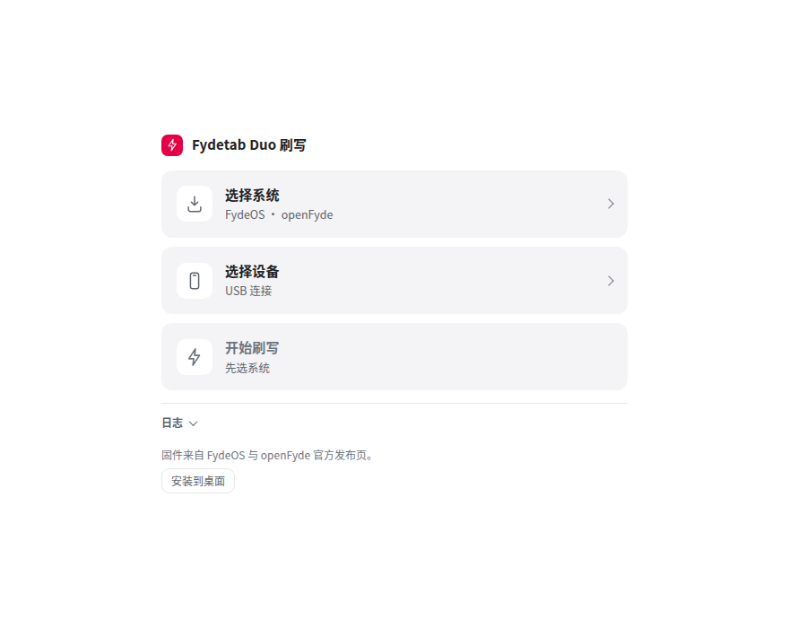
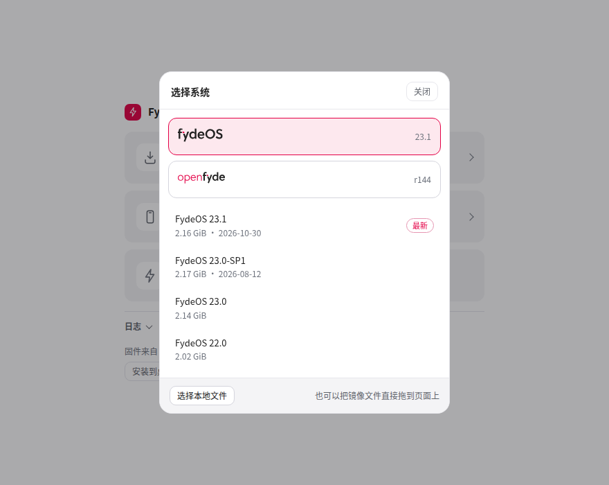
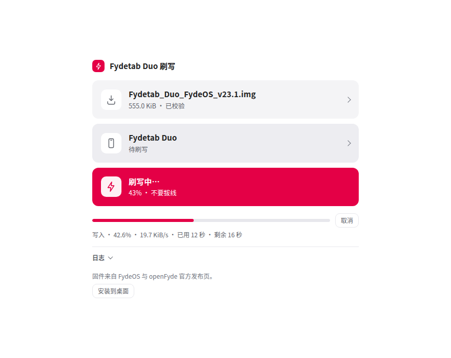
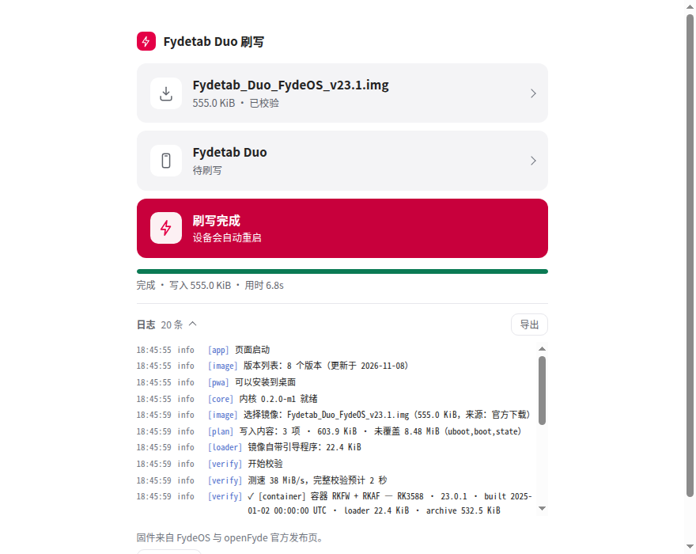
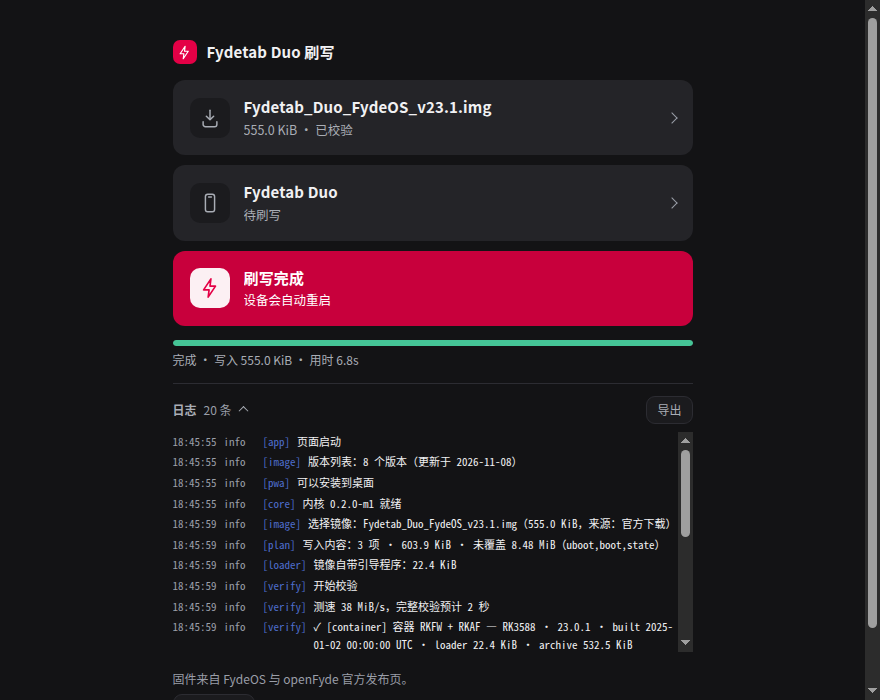
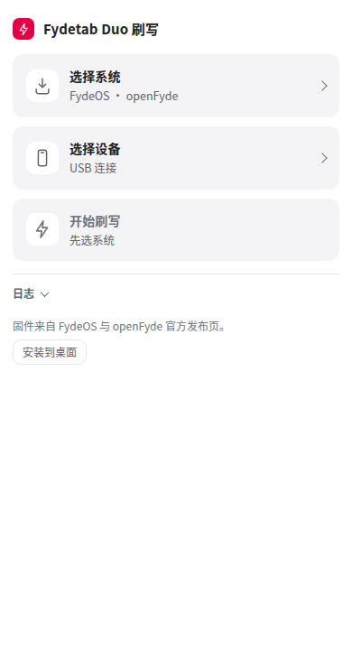

# fydetab-flash-web

[English](README.md) · **简体中文**

专为 **Fydetab Duo（RK3588）** 开发的浏览器刷机页。任何能跑 Chrome / Chromium 的机器都能用 ——
macOS、Linux、Windows、ARM 小主机 —— 不必再迁就官方 `upgrade_tool` 那套只支持 x86 Linux / Windows 的工具。

没有后端、不上传、不装额外软件：rockusb 协议与写入状态机用 Go 编译成 WebAssembly，USB 走 WebUSB，
镜像与设备都不离开本机。

## 界面

<table width="100%">
  <tr>
    <td width="33%" align="center"> 空状态 —— 下载镜像（可选）、选本地镜像、选设备、开始刷写</td>
    <td width="33%" align="center"> 下载镜像：先选品牌，再选版本</td>
    <td width="33%" align="center"> 写入中 —— 最后一块变品牌红</td>
  </tr>
  <tr>
    <td width="33%" align="center"> 完成 —— 设备自动重启</td>
    <td width="33%" align="center"> 暗色主题跟随系统</td>
    <td width="33%" align="center"> 390px —— 仍是单列，无横向溢出</td>
  </tr>
</table>

## 刷一台设备

1. **进刷写模式。** 平板关机，接好 USB，按住 **Vol+**，点一下 **电源**，先松电源再松 Vol+。
   进的是 MASKROM 时页面会自动先发 Download Boot —— 在此之前不要点任何读取按钮。
2. **下载镜像（可选）。** 点第一块，选 FydeOS 或 openFyde 再挑版本：浏览器自己下载，页面不跟踪进度，
   也不要求回来确认。已经有镜像的话这一块直接跳过。
3. **选择本地镜像。** 点第二块（或把文件拖到页面上）选刚下好的 `.img` / 官方 `.zip`。这一步和上一步
   没有先后关系。
4. **连接设备。** 点第三块，在浏览器弹窗里选那个 `0x2207` 设备。
5. **校验。** 解析、PARM CRC、RKAF CRC、整镜像 MD5 自动跑，页面上只有一行结论。
6. **开始刷写。** 镜像没覆盖全部空间时先说清尾部怎么处理，再点「开始刷写」。进度、速度、剩余时间贴在
   最后一块下面，随时可以取消。
7. **看日志。** 默认收起，出错自动展开，可导出 NDJSON；出问题就把它留着。

需要 Chrome / Edge / Chromium ≥ 89 和一根能传数据的 USB-C 线。Linux 装一条
[udev 规则](docs/99-rockchip-webusb.rules)，Windows 换成 WinUSB，macOS 什么都不用装。

## 文档

详细文档见 **[docs/README.md](docs/README.md)**（目前均为中文）。

- 第一次刷机，一步一步： [docs/quickstart.md](docs/quickstart.md)
- 页面细版说明（上面六步的长文）： [docs/usage-web.md](docs/usage-web.md)
- 驱动、授权、离线 PWA： [docs/webusb-drivers.md](docs/webusb-drivers.md)、[docs/pwa-offline.md](docs/pwa-offline.md)
- 自己构建： [docs/development.md](docs/development.md)

## 许可

GPL-2.0，见 [LICENSE](LICENSE)。本仓库不分发 `upgrade_tool` 二进制，也不分发 Rockchip loader blob；
loader 从你自己提供的镜像里切出。
