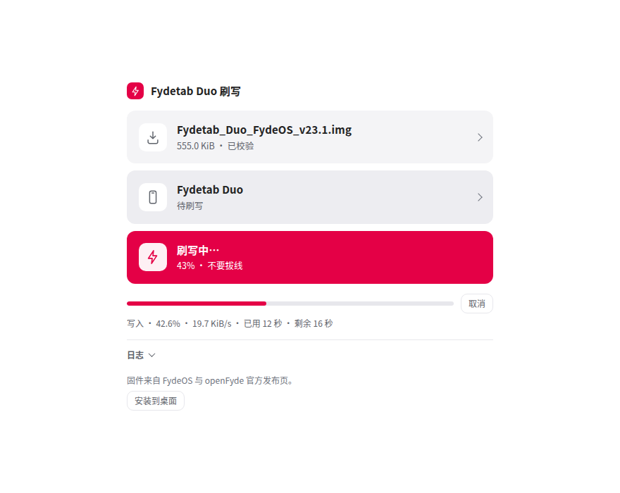

# 页面设计：Etcher 的骨架，FydeOS 的样子

这一页只做一件事：**把 Fydetab Duo 的官方系统刷进去**。它不是调试面板，所以页面上看不到协议名、字节数、
CRC、DevNo 或任何“高级”开关——需要这些东西的人看日志，日志可以导出。

版式参考 [balenaEtcher](https://etcher.balena.io/)：一个窄列、三块等大的操作块、进度贴在所属那块下面、
没有多栏也没有侧边栏。视觉语言仍是 FydeOS VI（主色 `#E40046`、中性 `#222222` / `#FFFFFF`、
辅助色只用于语义），没有 Etcher 的霓虹与深色玻璃感。

```
① 选择系统    FydeOS · openFyde      → 抬眼罩一层对话框，选品牌再选版本
② 选择设备    USB 连接               → 对话框里列出已授权的板子
③ 开始刷写    先选系统 / 覆盖原有系统 → 唯一的主色块，缺什么就在副标题写什么
日志          默认收起，展开 220px 可滚，可导出 NDJSON
```

三块都是 72px 高、12px 圆角、无边框的浅灰面（`--sunken`），图标是 40px 的白色圆角方块。
只有第三块在可写时变成品牌红；不可写时和上面两块同色，副标题说明还差什么——用颜色表示
“这一步能不能按”，不用禁用态灰掉整块。



版式：520px 单列、4px 间距体系、字号 22 / 16 / 15 / 13 / 12。

## 1 · 选择系统：一个对话框，两级选择

点「选择系统」打开 `#image-dialog`。对话框里先两行品牌条（官方字形，`web/app/brand.js`
内联 SVG，`currentColor` 跟随主题），点一行即展开该品牌的版本列表——不用再进一层：

- 每行：版本名、大小、发布日期；第一条带「最新」标签。
- 点一行就下载（能直读时流式写盘），不能直读时改在新标签页打开并提示选本地文件。
- `.xz` 的 openFyde 版本标注「需先解压」：页面只读 `.img` 与 `.zip`。
- 对话框底部是等价的第二入口「选择本地文件」；拖放也行，但不写说明书。

选完之后整块变成文件名 + `大小 · 已校验`，所以“选了什么”永远在页面上，不需要打开对话框确认。

### 版本清单（`web/app/images.json`）

静态文件，离线可读、PWA 预缓存。字段：

```json
{
  "id": "fydeos-23.1",
  "brand": "fydeos",
  "label": "FydeOS 23.1",
  "version": "23.1",
  "released": "2026-10-30",
  "file": "FydeOS_FydeTab_Duo_v23.1-com.img.zip",
  "size": 2324223767,
  "sha256": "85369d63…0b0dea",
  "url": "https://download.fydeos.io/v23.1/…img.zip",
  "page": "https://fydeos.com/download/device/fydetab_duo-fydeos/"
}
```

- 品牌内按 `released` 倒序，页面把第一条当“最新”。
- `size` / `sha256` 取自发布页与 GitHub Release body，仅作参考显示；真正保证完整性的是校验阶段的
  PARM CRC、RKAF CRC 与整镜像 MD5。
- 刷新清单：改这个文件即可，页面不用改。FydeOS 的版本号来自
  <https://fydeos.com/download/device/fydetab_duo-fydeos/>，openFyde 来自
  <https://github.com/openFyde/overlay-fydetab_duo-openfyde/releases>。

### 下载：先探测，再流式写盘

1. **探测**：同源直接用；跨域先 `HEAD`，服务器不答 HEAD 就用 `Range: bytes=0-0` 的 `GET`，检查
   `Access-Control-Allow-Origin`。没有它，脚本无权读这个响应（状态码 200 也不够）。
2. **不允许就直说**：给出「在新标签页下载」的真链接，并提示下载后在「选择系统」里选本地文件。
3. **允许就流式写盘**：`showSaveFilePicker` → `FileSystemWritableFileStream`，读一块写一块，
   2 GiB 镜像不进内存。进度条出现在三块下面，标着「下载」。
4. 浏览器没有 File System Access API（Firefox / Safari）时，下载区直接写明改用本地文件。

下载完成后直接进入计划与校验，不需要再选一次。

## 2 · 校验：只写日志，不当页面内容

选好镜像就自动开始，页面上只有一行结果（`5.10 KiB · 已校验`）。逐项结论、耗时、CRC 数字全部进日志。

| 层 | 内容 | 成本 |
|---|---|---|
| 结构 | RKFW/RKAF/parameter 解析、item 边界、分区数、未覆盖区间、payload 偏移 | 秒级 |
| PARM CRC | parameter 段很小，直接算 | 秒级 |
| 整镜像 MD5 + RKAF CRC | 分块流式扫全文件 | 与文件大小成正比 |

页面先用 64 MiB 取样测出本机吞吐，再外推完整校验耗时：≤ 2 分钟就默认做完整校验，超过就退回快速校验，
日志里写明“未做完整校验”。实测（Ryzen 7 5700X，Go/WASM 约 700 MiB/s）8.36 GB 镜像约 11 秒，
所以正常机器上都是完整校验。

阻断写入的：结构错误、PARM CRC 不匹配、RKAF CRC 不匹配（stored ≠ 0）、整镜像 MD5 不匹配。
RKAF CRC 尾部是 `00000000` 时按既定规则视为“未填写”，只警告、不当作损坏。

## 3 · 选择设备：一个对话框，一行一台

点「选择设备」打开 `#device-dialog`，里面是：

- `navigator.usb.getDevices()` 列出所有已授权的 `0x2207` 设备，并订阅 `connect` / `disconnect`。
- 一行一个设备：产品名 + 一句状态（`已就绪` / `待刷写` / `未知`）。只有同时连着两台时才显示序列号。
- 没有设备时只有一个虚线大目标「连接设备」，触发 `requestDevice`。
- 只有一个候选时自动选中，不需要先点一下；点一行即选中并关掉对话框。

选完之后这一块变成「Fydetab Duo · 待刷写」，和系统那块对称。协议模式（maskrom / loader）
不翻译给用户看：页面自己决定要不要先发 Download Boot。`db` 之后设备会重新枚举、浏览器会
撤掉按实例的授权：页面按序列号重新匹配，匹配不上就在三块下面给出重连的三步。

## 4 · 开始刷写：一块，缺什么就写什么

前置条件仍然是 `web/app/preflight.js` 里那张清单（**原有条件一条没删、没有放宽**），但页面只显示
**挡住写入的那几条**，全部满足时清单整块消失，这块变成品牌红并可直接点。

副标题一行永远只说当前那一件事，依次是：`先选系统` → `先连接设备` → `确认未覆盖空间` →
`覆盖设备上的原有系统` → 写入时的 `43% · 不要拔线` → 完成后的 `设备会自动重启`。
不用“前置条件失败”这类词。

镜像没覆盖全部空间时，不用“前置条件失败”去吓人，而是单独一行提问：
「镜像没覆盖 8.48 MiB 空间，这部分怎么处理？」+ 下拉框（保持原样 / 填 0xFF / 整段擦除）+「就按这个处理」。
这一行只在设备连上之后才出现——问题放到用户能动手处理的那一刻问。勾上之后行本身消失，按钮亮起。

清单里只留 `fail` 的状态：`pending` 是把空状态的建议再说一遍，`pass` 更不需要宣告。
镜像本身打不开时只留「镜像已校验」一条，计划和引导程序那两条不再跟着复述。

写入中进度条贴在第三块下面（阶段 `ul`/`db`、`gpt`、`wl <item>`、`rd`、百分比、速度、已用/剩余时间），
旁边一个「取消」。失败时给出下一步（重试 / 重进 maskrom / 换线换口 / 导出日志），日志一定保留。

## 5 · 日志：在最下面，默认收起

- 打开后 220px 高、自己滚动，不再撑高页面；出现 `error` 会自动展开。
- 分级 `debug/info/warn/error`，带时间戳与来源（`[image]`、`[verify]`、`[device]`、`[write]`…）。
- 收起时标题旁只写警告/错误条数；展开后才显示总条数。
- 「导出」给出 NDJSON（`application/x-ndjson`，含 header 与环境信息）：镜像、校验结果、计划、
  设备状态、每一步进度都在里面。内存上限 5000 条，超出时文件里会写明丢了多少条；一条都没有时不显示这个按钮。
- 页面上没有清空按钮：日志是故障现场，刷新页面就会清掉。

## 落地位置

| 关注点 | 文件 |
|---|---|
| 页面结构 | `web/app/index.html`、`web/app/styles.css` |
| 页面状态与流程编排 | `web/app/app.js` |
| 品牌字形（官方 SVG） | `web/app/brand.js` |
| 版本清单、CORS 探测、流式下载 | `web/app/images.json`、`web/app/images.js` |
| 校验策略（阻断 / 警告 / 2 分钟规则） | `web/app/verify.js` |
| 设备列表与重新枚举规则 | `web/app/devices.js` |
| 日志仓库与导出 | `web/app/logs.js` |
| 写入门禁（语义未变） | `web/app/preflight.js` |
| 结构与校验和执行 | `cmd/wasm/verify.go`、`internal/rkfw` |

页面上没有演示 / mock 入口。worker 仍然支持 mock 设备（它自己的测试在用），但页面从不请求它：
看到的就是真实的 WebUSB 设备，或者什么都没有。

## 已知限制

- 两个官方站点都不返回 `Access-Control-Allow-Origin`，所以「点一下就在页面里下载」目前走不通，
  实际是“新标签页下载 → 选择文件”。要变成一键下载，需要发布方加 CORS 头。
- 页面不重算整文件 sha256（浏览器没有流式 digest），清单里的 sha256 只作参考。
- openFyde r144 / r126 发布为 `.img.xz`，页面不读 xz：先解压再选 `.img`。
- `.zip` 做完整校验会多一次按需解压的成本，取样测速已经包含这一步。
