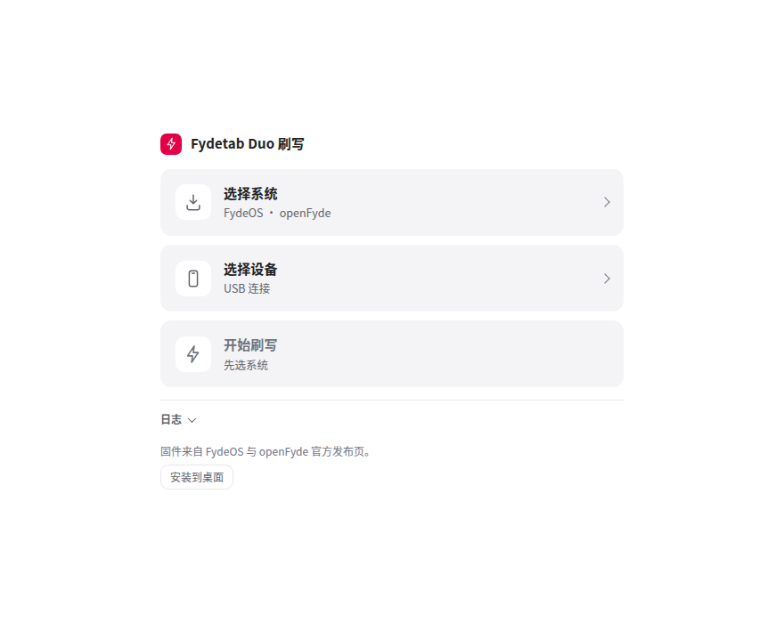
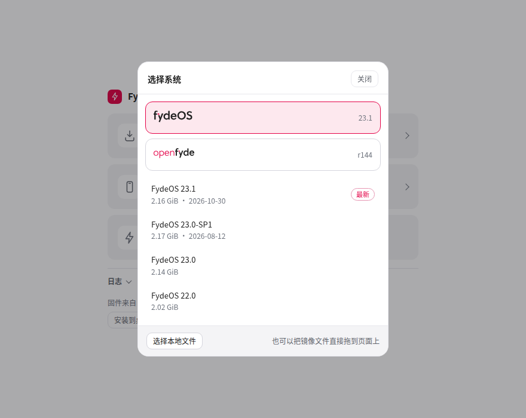
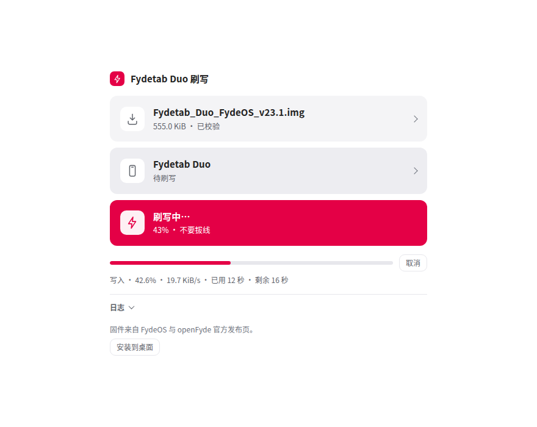
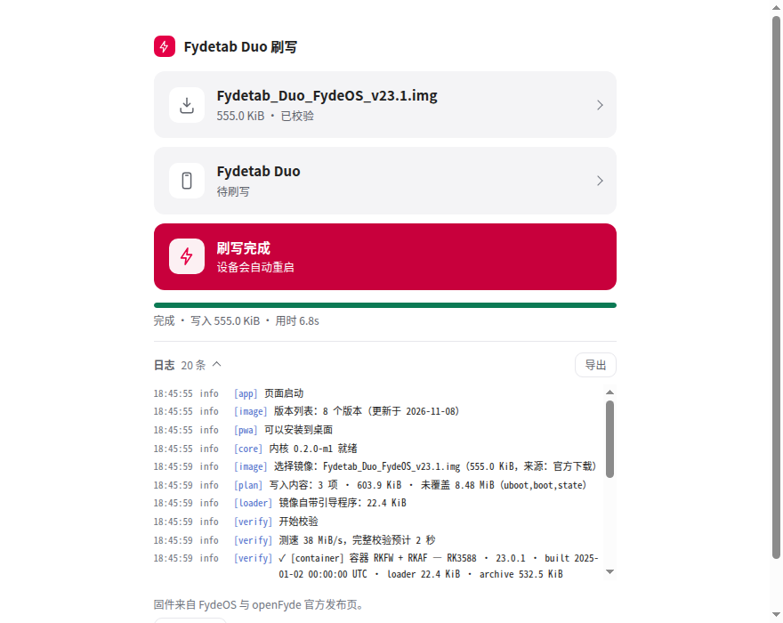
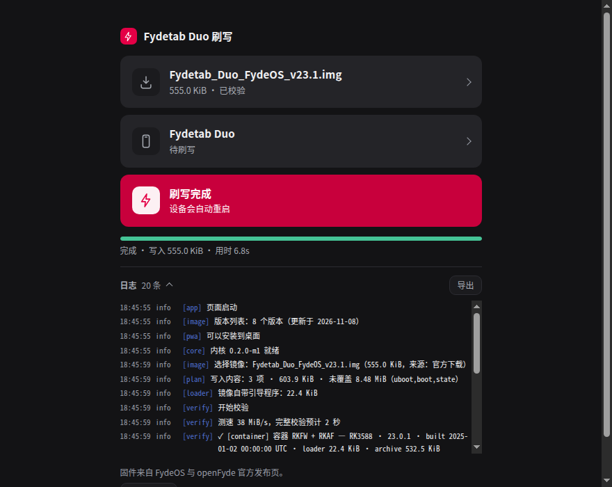
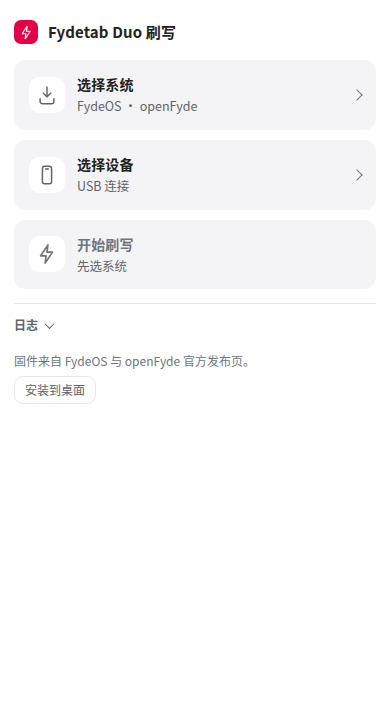

# 页面使用：真实设备

开发版页面：`pixi install` 后运行 `pixi run dev`，打开 `http://localhost:5173/app/`
（M0 只读探针在 `/probe/`）。安装版 PWA 的完整上手流程见 [quickstart.md](quickstart.md)；
页面结构与校验策略见 [m4b-ui.md](m4b-ui.md)。

## 一次完整的刷写

页面只有一条竖线：三块等大的操作块从上到下排着，下面是默认收起的日志。还没选系统时，第三块的副标题
就直接写着「先选系统」，不用去猜这一步缺什么。

1. 平板进 **MASKROM 或 LOADER**（按住恢复键上电或按板子说明短接），USB 接入。
   **这一轮上电后不要先点任何读取按钮**——maskrom 下第一条命令必须是 Download Boot。
2. 打开页面，在 **设备** 里点 **连接设备**，在浏览器弹窗里选那个 `0x2207` 设备。连上就自动选中。
3. 在 **选择系统** 里点 FydeOS 或 openFyde，挑一个版本下载；或者点 **选择本地文件** 用已经下好的镜像
   （`.img` 或官方 `.zip`）。选完自动生成计划并开始校验，页面上只留一行结果。

   

   对话框里是两级选择：点 `fydeOS` / `openFyde` 展开该品牌的版本列表，每行带大小与发布日期，
   第一条标「最新」。右下角的「选择本地文件」是等价入口，拖放到页面上也行。

4. 等那行变成「校验通过」。需要细节就展开 **日志**：结构、PARM CRC、RKAF CRC、整镜像 MD5 逐项都在里面。
5. 如果出现「镜像没覆盖 X MiB 空间，这部分怎么处理？」：选一种处理方式（一般「保持原样」），
   勾上「就按这个处理」。第三块 **开始刷写** 随即亮起。
6. 点 **开始刷写**。状态机自己执行 `db → gpt → wl … → rd`；第三块变品牌红，进度条贴在它下面，
   写着阶段、百分比、速度、已用/剩余时间，旁边随时可以取消。失败时页面会给出下一步
   （重试 / 重进 maskrom / 换线换口 / 导出日志）。

   

7. 完成后设备自动重启；重新连上后 **设备** 里应该显示「已就绪」。

   

   完成时第三块写「刷写完成 / 设备会自动重启」，下面一行是摘要（写入量、耗时）。日志这时可以整段导出，
   出问题就把它一起带上。

> 引导程序（loader）由镜像自带，仓库不分发 Rockchip loader blob，也不联网获取。

## 暗色与窄屏

主题跟随系统，不需要开关；配色全部走同一套 token，暗色下三块的面色、品牌红与日志的等宽字体保持一致。

手机上也刷不了机（WebUSB 不在移动浏览器里），但页面在 390px 下不横向溢出，方便在手机上照着步骤操作电脑：

## 为什么页面上没有“演示模式”

这一页是给用户刷机的，不是调试台。演示 / mock 设备只留在 worker 自己的测试里
（`web/app/test/worker.test.mjs` 等），页面从不请求它：看到的设备就是真的，否则就是一个都没有。
想在没有硬件的情况下验证代码路径，用 `pixi run sample` + 本地文件 + CLI 的 `--mock`，见
[cli.md](cli.md) 与 [development.md](development.md)。

## 界面语言

页面有中文与英文两套文案，按浏览器语言自动选：`navigator.languages` 里第一个 `zh*` 用中文、第一个
`en*` 用英文，两者都没有就用英文。想固定一种语言看效果，在地址后加 `?lang=zh` 或 `?lang=en`
（页面上没有语言开关；切换后刷新即可）。

## 离线

装成 PWA 之后页面与 wasm 都来自本地缓存，断网也能打开并完成写入（写入本来就不需要网络）。
安装、缓存项与 `.zip` 直读细节见 [pwa-offline.md](pwa-offline.md)。

## 驱动与授权

macOS arm64 / Linux / Windows 的 WebUSB 说明见 [webusb-drivers.md](webusb-drivers.md)；Linux 的 udev 规则
可直接装 [`99-rockchip-webusb.rules`](99-rockchip-webusb.rules)。设备重新枚举后授权会失效，需要重新选择或
授权设备；这是浏览器按“来源 + 设备实例”授权的行为，不是页面 bug。

## 相关文档

- 安装版 PWA 全流程（含救砖）：[quickstart.md](quickstart.md)
- 页面结构与校验策略：[m4b-ui.md](m4b-ui.md)
- 安装、离线、zip 直读：[pwa-offline.md](pwa-offline.md)
- 设备模式与命令：[device-commands.md](device-commands.md)
